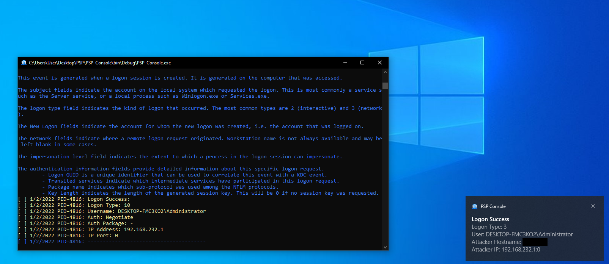
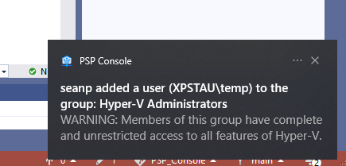

# Personal Security Product

Sean Pierce

As normal computer user, I've always been a little miffed that I don't have a basic awareness of who is remotely accessing/scanning/attacking my machine. So I created this program to simply notify me of the most obvious events I would want to know about. I'm making/testing this as I go along and I add things when something jumps out to me as an attacker. I'm not implementing a stig checker / attack surface analyzer but I will list remote access oriented things such as LocalAccountTokenFilterPolicy. Everything here is just a PoC; When I get serious I will re-implement it as a service, with a real installer and updater.

## Download
[Latest Version Here](https://github.com/securesean/PSP/releases)

## Features:
- When something attempts to remotely accessing/scanning/attacking my machine a toast notification will notify the user
- Full details are writen to %Programdata%\PSP_Logs
- Toast on-click event opens the xml log 
- `--test` will test about half the events to verify end-to-end functionality 
- Supported Events:
   - 4624 - Logon Success 
   - 4625 - Logon Failed 
   - 4697 - Service Installed
   - 1102 - Security Log Cleared
   - 4798 - Local Group Enum (a little noisy sometimes)
   - 4726 - User Deleted
   - 4720 - User Created
   - 4722 - User Enabled
   - 4732 - User Added To Group
   - 4622 - Lsass Loaded Package
   - 4614 - Notifcation Package Loaded
   - 4611 - Lsass Logon
   - 4610 - Lsass Loaded Auth Package
   - 4648 - User Logon With Creds
   - 4724 - Password Reset

## How to Install
- Double click and it should pop a UAC prompt
- Enable "Security System Extension" to support these events: https://www.windows-security.org/b355febe2c7a2ae1eaba46c4470d6d4a/security-system-extension . See if your machine is already collecting them with the command: `AuditPol /get /category:* | grep "Security System Extension"` By default it will say, "No Auditing". We (probably) need it to say, "Success"
 - Inspired based on: https://www.stigviewer.com/stig/windows_7/2017-12-01/finding/V-26556 Fix Text (F-29805r1_fix)
 - GUI - secpol.msc  https://docs.microsoft.com/en-us/windows/security/threat-protection/security-policy-settings/how-to-configure-security-policy-settings enable "Audit Security System Extension" . C# - https://docs.microsoft.com/en-us/dotnet/api/system.security.accesscontrol.filesystemauditrule?view=net-6.0
 - GUI - gpedit.msc: Computer Configuration\Windows Settings\Advanced Audit Policy Configuration\System -> "Audit Security System Extension"
WARNING: I am not a Windows Logging expert and I have observed that making these changes via the GUI will supress other events

## How to Compile:
- Right click on the project in the "Solution Explorer" and choose, "Manage NuGet Packages" and install, "Microsoft.Toolkit.Uwp.Notifications"
- Click Build Solution

## Future Feature Ideas:
- Add start-up folder lnk persistence
- Add seconds to log output
- Insert Version checking simple CSV: version,hash,message. Toast -> URL to git downloads page
- Add button to "never show this message again" for common events
- Include/Display Basic License with EULA (gross I know)
- Better logging on the reason for a crash
- After self testing, and finding that some events are not enabled, see if I can't automatiaclly enable them (such as service installed events). Look at  https://github.com/rkovar/PowerShell/blob/master/audit.bat
- Automatic port scanning of would-be attacker machines who have attempted remote logons
- Alert on Windows Security Log Event ID 4799: https://learn.microsoft.com/en-us/previous-versions/windows/it-pro/windows-10/security/threat-protection/auditing/event-4799
- Alert on Windows Security Log Event ID 4798: https://learn.microsoft.com/en-us/previous-versions/windows/it-pro/windows-10/security/threat-protection/auditing/event-4798
- Alert on securable objects being accessed: https://github.com/OTRF/Set-AuditRule
- Look at 7030, 7036, 7045, 7040, 104, 4688, 4672, 4720, 4728, 4732, "4756", "4625", "4673", "4674", "4648", "1102", App - 2, AppLocker - "8003", "8004", "8006", "8007", PowerShell - "4103", "4104", SysMon "1", "7", Test Event Number "1033", "1107" from https://github.com/ManuelBerrueta/BST/blob/main/Windows/Search_EVTX_LogEvents.ps1 and https://github.com/sans-blue-team/DeepBlueCLI
- Alert on malicious looking WinRM commands under Microsoft-Windows-WinRM/Operational (Event ID 91).
- Check for local token filter policy
- Check for local firewall settings 
- Alert if FireWall is disabled
- Alert if FireWall rule has been added so a process can start listening?
- Alert if a service starts listening on a port?
- Alert if any service starts listening on a port?
- Do basic security checks such as WinRm/RDP is enabled, Guest is enabled and is in groups, the Admin account is enabled with default name. Look at stigs for inspiration . 
- Print basic information such as "X number of users can access this computer remotely via RDP, SMB/RPC/DCOM, WinRM"
- Alert idea: Something started listening on a port
- Look into WinRM logs: Microsoft-Windows-WinRM-Operational
- Look into PowerShell log monitoring https://github.com/GoateePFE/PowerShellSummit2019/blob/master/Lab_01_PowerShell_Policies.md
- Maybe: When an lsass dump file is created
- ToDo: Add to --test : after increasing logging, reboot and test again (requires persistence)
- Maybe: Run autoruns periodicly and display any newly installed persistence
- Maybe: Install sysmon for... network connection lists ('x' is beaconing to 'y'), securely deleted files, Create Remote Thread?
- Create persistence so it run on logon
- Target classic tools:
   - https://blog.menasec.net/2019/03/threat-hunting-26-remote-windows.html 
   - https://jpcertcc.github.io/ToolAnalysisResultSheet/
- Build automated self tests
- Make a 'Lock down feature' that will stop WinRM,LanMan,RDP,SSH and start listening on those ports
- Add an evaulation phase/mode/startup 
   - list all users/groups in local admin groups
   - resursively lookup domain groups and users in admin groups
   - list weird services
   - list and programs listening on any ports
   - list the services running on those ports 
   - detect if "System Security Extention" is enabled
- Automatically enable additional logging such as "(Audit) System Security Extention" to start producing events such as 4697 (Service Installed)
- Add button to all events, "Don't show any more alerts with this information" 
- Add default actions to the Toast notifications ('Block IP', 'Start watching for new processes as that user/Service', 'scan for yara sigs', 'Check VT for Exe', 'Launch Autoruns', 'Kill Service', 'Log off user and reset password', etc.)
- Add a better sound for the Toast Notification
- Add icons for the Toast Notification
- Add icons for the Toast Notification buttons - https://docs.microsoft.com/en-us/windows/apps/design/shell/tiles-and-notifications/adaptive-interactive-toasts?tabs=builder-syntax
- Reimplement as a service
- Reimplement as a Red Team situational awareness tool
- subscribe to events on a remote computer: https://docs.microsoft.com/en-us/previous-versions/bb671202(v=vs.90)?redirectedfrom=MSDN
- Send toast notications to a remote computer
- Perhaps look at implementing good basic perodic execution rules? (Example: High Entropy file names, known malicious exe names, known malicious pipe names, or rundll32 without any arguements, etc.)
- Other periodic checks (pre-fetch files deleted)
- Vaccine capabilitiy - launch known analysis tool file names, mutex's
- Perhaps look at what a local sigma instance might look like?
- Pull down public domain/ip known malicious ip's/domains 
- Leverage intel from https://strontic.github.io/xcyclopedia/

## In next re-write:
- Create a real Updater
- Make real User & Group Objects
- Make better rule logic flow (instead of messy if statements before every toast notification)
- Make better self tests

## Credits
Icon from: https://icon-icons.com/download/127074/ICO/512/
